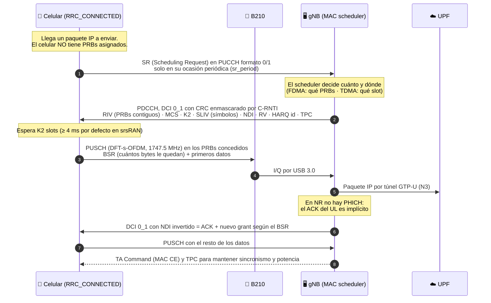
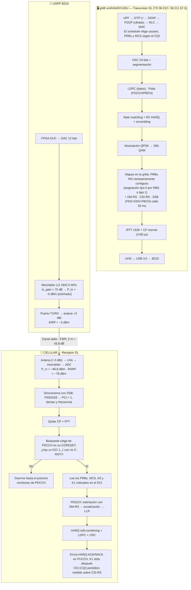
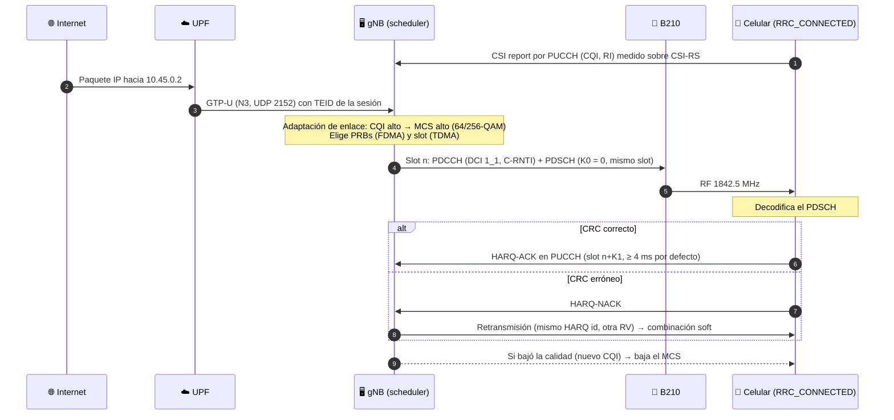
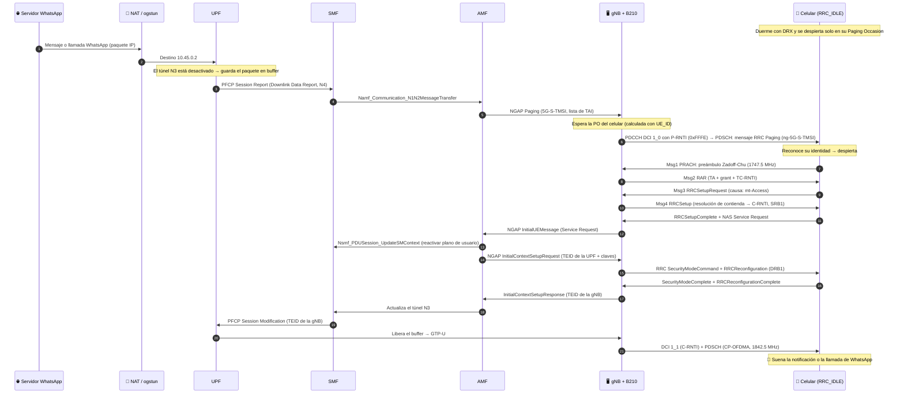

# Diagramas de Uplink, Downlink y Paging — Celda 5G SA n3 FDD con USRP B210

**Configuración de la celda:** banda n3 FDD · DL 1842.5 MHz (NR-ARFCN 368500) · UL 1747.5 MHz (NR-ARFCN 349500) · Δ dúplex 95 MHz ·
μ = 0 (SCS 15 kHz, slot de 1 ms, 14 símbolos) · 20 MHz → 106 PRB = 1272 subportadoras · `srate` 23.04 MS/s · SISO 1×1 · PLMN 722/999 · PCI 1
**Normativa:** 3GPP Release 15: TS 38.211 (canales y modulación), 38.212 (codificación), 38.213 (control de capa física), 38.214 (datos),
38.321 (MAC), 38.331 (RRC), 38.304 (paging en IDLE), 38.101-1 (RF del UE), 23.502 (procedimientos del core).

---

## 0. Análisis del diagrama de bloques actual

| Aspecto | Estado | Qué le faltaba (y cubre este documento) |
| :--- | :--- | :--- |
| Dominios RAN / Core / Internet | ✅ Bien separados: los métodos de acceso solo existen en la RAN | — |
| Recuadros "Métodos de acceso UL/DL" | ⚠️ Listan parámetros pero no muestran el procesamiento | Cadena TX → canal → RX bloque por bloque (§1 y §2) |
| Potencias y sensibilidad | ❌ No aparecen | Presupuesto de enlace (link budget) DL y UL (§2.3) |
| Puertos de la B210 en FDD | ❌ No se indica | TX por el puerto **TX/RX** (1842.5 MHz) y RX por **RX2** (1747.5 MHz), con las antenas separadas para aislar |
| Celular sin recursos asignados | ❌ No contemplado | RRC_IDLE + DRX + paging (§3) |
| Notas pendientes del draw.io | "sensibilidad DL/UL", "si el teléfono no pide PRBs" | §2.3 y §3 |

**Idea clave para la defensa:** el celular **nunca usa PRBs por su cuenta**. En UL siempre los **pide** (SR/BSR) y la gNB se los **concede** (DCI 0_x).
En DL la gNB **decide** y **avisa** (DCI 1_x) dónde van los datos. Si el celular está en IDLE, la red primero lo **despierta** con paging.

---

## 1. UPLINK (celular → gNB): DFT-s-OFDM sobre FDD

### 1.1 Cadena de transmisión y recepción

```mermaid
flowchart TB
    subgraph UE["📱 CELULAR — Transmisor UL (TS 38.212 / 38.211 §6.3.1)"]
        direction TB
        U1["MAC: Transport Block<br/>datos IP + BSR/PHR"] --> U2["CRC 24 bits<br/>(TS 38.212 §6.2.1)"]
        U2 --> U3["Codificación LDPC<br/>BG1 bloques grandes / BG2 chicos"]
        U3 --> U4["Rate matching + versión de redundancia HARQ (RV)"]
        U4 --> U5["Scrambling con C-RNTI"]
        U5 --> U6["Modulación<br/>π/2-BPSK · QPSK · 16/64/256-QAM"]
        U6 --> U7["Transform precoding = DFT de M = 12·N_PRB puntos<br/>(N_PRB = 2^a·3^b·5^c) → baja PAPR"]
        U7 --> U8["Mapeo en PRBs CONTIGUOS (asignación tipo 1, RIV)<br/>+ DM-RS (piloto de demodulación)"]
        U8 --> U9["IFFT 1536 puntos + CP<br/>CP = 108 muestras (120 en símbolos 0 y 7) → 23040 muestras/slot"]
        U9 --> U10["Timing Advance: adelanta el slot N_TA"]
        U10 --> U11["DAC → mezclador LO 1747.5 MHz → PA<br/>Potencia según control de potencia (≤ +23 dBm, Power Class 3)"]
    end

    U11 -- "Canal radio Uu · FSPL 2 m ≈ 43.3 dB" --> R1

    subgraph B210["📡 USRP B210 — Radio Unit (split 8)"]
        direction TB
        R1["Antena en puerto RX2"] --> R2["LNA + mezclador LO 1747.5 MHz<br/>rx_gain ≈ 45 dB"]
        R2 --> R3["ADC 12 bits · 23.04 MS/s<br/>FPGA: DDC + timestamps"]
        R3 --> R4["USB 3.0: muestras I/Q a la PC"]
    end

    subgraph GNB["🖥️ gNB srsRAN/OCUDU — Receptor UL (PHY → MAC)"]
        direction TB
        G1["Quitar CP + FFT 1536"] --> G2["Extraer los PRBs concedidos"]
        G2 --> G3["Estimación de canal con DM-RS + ecualización de 1 tap"]
        G3 --> G4["IDFT (transform de-precoding)"]
        G4 --> G5["Demodulación → LLR soft + descrambling"]
        G5 --> G6["Combinación HARQ + decodificación LDPC (AVX-512)"]
        G6 --> G7{"¿CRC OK?"}
        G7 -- "Sí" --> G8["MAC → RLC → PDCP → SDAP → GTP-U (N3) → UPF"]
        G7 -- "No" --> G9["Retransmisión: nuevo DCI 0_x<br/>con el mismo NDI (otra RV)"]
    end

    R4 --> G1
```



**Explicación de cada bloque:**

*📱 Celular (transmite):*
1. **Transport Block (MAC):** la MAC junta en un bloque de bits todo lo que se manda en este slot: los datos IP y los reportes BSR/PHR.
2. **CRC 24 bits:** agrega 24 bits de control para que el receptor pueda saber si el bloque llegó bien o mal.
3. **Codificación LDPC:** agrega bits redundantes para corregir errores sin tener que retransmitir. Usa BG1 para bloques grandes y BG2 para chicos. *Qué es y cómo funciona: §1.3-A.*
4. **Rate matching + RV:** recorta o repite bits para que entren **justo** en los PRBs concedidos. Si hay un reenvío, se manda otra "parte" de los bits (otra versión de redundancia, RV).
5. **Scrambling:** mezcla los bits con una secuencia propia del celular (C-RNTI), así la señal de otro usuario se ve como ruido. *Detalle de la secuencia y para qué sirve: §1.3-B.*
6. **Modulación:** agrupa bits en símbolos complejos: QPSK = 2 bits, 64-QAM = 6 bits. Con mejor señal se usan más bits por símbolo.
7. **DFT (transform precoding):** reparte cada símbolo sobre todas las subportadoras asignadas. La señal queda con menos picos (PAPR) y el amplificador del celular gasta menos batería. **Este paso es lo que convierte el UL en DFT-s-OFDM.** *Efecto sobre la PAPR y el celular: §1.3-E.*
8. **Mapeo en PRBs contiguos + DM-RS:** ubica los datos en los PRBs que concedió la gNB, que tienen que ser contiguos por la DFT, y suma pilotos DM-RS (valores conocidos) para que la gNB pueda medir el canal.
9. **IFFT + CP:** pasa de frecuencia a tiempo (genera la señal OFDM) y copia el final de cada símbolo al principio. Ese prefijo cíclico (CP) absorbe los ecos. *Por qué 1536 puntos encajan justo con 23.04 MS/s: §1.3-C.*
10. **Timing Advance:** el celular transmite un poco antes para compensar la distancia y llegar alineado al slot de la gNB.
11. **DAC → 1747.5 MHz → PA:** pasa la señal a analógico, la sube a la frecuencia de UL y la amplifica con la potencia que fija el control de potencia (máximo +23 dBm).

*📡 USRP B210 (recibe):*

12. **Antena en RX2:** recibe por el puerto RX2. El puerto TX/RX queda libre para transmitir el DL a 1842.5 MHz al mismo tiempo (FDD).
13. **LNA + mezclador:** amplifica la señal débil agregando poco ruido y la baja a banda base.
14. **ADC + FPGA:** digitaliza 23.04 millones de muestras I/Q por segundo y la FPGA les pone marca de tiempo.
15. **USB 3.0:** manda las muestras a la PC. La B210 **no entiende de PRBs ni de bits**: solo convierte la señal.

*🖥️ gNB (decodifica):*

16. **Quitar CP + FFT:** descarta el CP (donde cayeron los ecos) y pasa de tiempo a frecuencia para recuperar cada subportadora.
17. **Extraer PRBs:** se queda solo con los PRBs que le había asignado a este celular.
18. **Estimación + ecualización:** compara los DM-RS recibidos con los conocidos, mide cuánto deformó el canal la señal y lo corrige con una división por subportadora.
19. **IDFT:** deshace la DFT del paso 7.
20. **Demodulación (LLR) + descrambling:** calcula para cada bit qué tan seguro está de que es 0 o 1 (un valor "soft" llamado LLR) y quita el scrambling. *Qué es un LLR y por qué conviene: §1.3-D.*
21. **HARQ + LDPC:** si es un reenvío, suma la copia anterior (más energía) y el decodificador LDPC corrige los errores.
22. **¿CRC OK?:** verifica el CRC del paso 2.
23. **Sí:** el paquete IP sube por MAC → RLC → PDCP → SDAP y va al core por el túnel GTP-U (N3).
24. **No:** pide reenviar con un nuevo DCI que tiene el mismo NDI.

**En resumen:** el celular convierte bits en una señal de radio robusta (pasos 1–11). La B210 solo la digitaliza (pasos 12–15) y la gNB deshace cada paso en orden inverso (pasos 16–24).
Lo propio del **método de acceso UL** está en los pasos 7–8 (DFT + PRBs contiguos = DFT-s-OFDM / FDMA) y en el 10 (todos los celulares tienen que llegar alineados al mismo slot = TDMA).

### 1.2 Método de acceso en el tiempo: cómo pide y obtiene recursos



**Paso a paso (los números coinciden con las flechas):**

1. **SR (pedido):** el celular avisa "tengo algo para mandar". Solo puede hacerlo en sus momentos reservados del PUCCH, que se repiten cada `sr_period`. Es como levantar la mano.
2. **DCI 0_1 (permiso o *grant*):** la gNB le contesta por el PDCCH con todo lo que necesita: **qué PRBs** usar (RIV, FDMA), **en qué slot** (K2, TDMA) y en **qué símbolos** (SLIV).
   También le indica **qué modulación y código** (MCS), si es dato nuevo o reenvío (NDI/RV) y un ajuste de potencia (TPC). El DCI va "marcado" con el C-RNTI del celular, así que solo él lo puede leer.
3. **PUSCH:** K2 slots después, el celular transmite en esos PRBs. Como el SR no dice cuánto tiene, aprovecha y manda un **BSR** con la cantidad de bytes que le faltan.
4. **I/Q por USB:** la B210 solo digitaliza y pasa las muestras a la PC.
5. **GTP-U:** la gNB decodifica, recupera el paquete IP y lo manda al core (UPF).
6. **ACK implícito + nuevo grant:** 5G no tiene un canal de ACK para el UL (el PHICH de 4G desapareció). Si el próximo DCI trae el **NDI invertido**, significa "lo anterior llegó bien, mandá lo nuevo".
   El tamaño del nuevo grant sale del BSR.
7. **PUSCH:** el celular envía el resto de los datos.
8. **TA y TPC:** la gNB corrige de vez en cuando el adelanto de tiempo (por si el celular se movió) y la potencia de transmisión.

> **Si el celular no pide recursos:** no transmite nada en PUSCH. Solo puede usar sus recursos periódicos de PUCCH (SR, CSI, HARQ-ACK).
> Si además está en IDLE, no tiene ni PUCCH y tiene que volver a entrar por **PRACH** (RACH de 4 pasos, ya documentado en el PNG del RACH).
> **En FDD n3 el PRACH usa preámbulo largo formato 0** (Zadoff-Chu L = 839, Δf_RA = 1.25 kHz).

> **Nota sobre la norma:** Rel-15 permite en UL tanto **CP-OFDM** como **DFT-s-OFDM** (se habilita con `transformPrecoder` / `msg3-transformPrecoder`).
> El diagrama de la cátedra usa DFT-s-OFDM. Hay que verificar en el `gnb.yml` o en el log que *transform precoding* esté habilitado. Si no lo está, el UL sale en CP-OFDM.

### 1.3 Conceptos clave de la cadena

#### A. ¿Qué es un código LDPC? (pasos 3 y 21)

**LDPC** (*Low-Density Parity-Check*, chequeo de paridad de baja densidad) es un **código corrector de errores**. Antes de transmitir se agregan bits de paridad calculados a partir de los datos. Si en el aire se dañan algunos bits, el receptor los puede **reconstruir sin pedir un reenvío**.

**La idea, con un ejemplo de juguete.** Se mandan 3 bits de datos (b1 b2 b3 = 1 0 1) y 3 bits de paridad calculados con XOR (⊕):

```
b4 = b1 ⊕ b2 = 1        Ecuaciones de paridad (todas deben dar 0):
b5 = b2 ⊕ b3 = 1          C1: b1 ⊕ b2 ⊕ b4 = 0
b6 = b1 ⊕ b3 = 0          C2: b2 ⊕ b3 ⊕ b5 = 0
Se transmite: 1 0 1 1 1 0 C3: b1 ⊕ b3 ⊕ b6 = 0
```
Si en el aire se invierte b3 (llega 1 0 **0** 1 1 0), fallan C2 y C3. El único bit que está en **las dos** ecuaciones que fallan es b3, así que el receptor sabe que es el que se dañó y lo corrige.

**Lo que tiene de especial el LDPC de 5G:**
- **"Baja densidad":** cada ecuación de paridad involucra **muy pocos bits** de entre miles. La matriz de paridad H (cada fila es una ecuación) es casi toda ceros. Por eso decodificar es barato aunque el bloque sea enorme.
- **Decodificación iterativa** (*belief propagation*):
  - Los bits y las ecuaciones intercambian "opiniones" (LLR, ver el punto D) durante varias vueltas, unas 5 a 10 iteraciones.
  - En cada vuelta, los bits dudosos se corrigen con la ayuda de los confiables.
  - Se termina cuando todas las ecuaciones dan 0 y el CRC cierra.
  - Muchas ecuaciones se procesan **en paralelo**, que es justo lo que aceleran las instrucciones AVX-512 del CPU de la gNB.
- **Cuasi-cíclico (QC-LDPC, TS 38.212 §5.3.2):** la matriz se arma a partir de una **matriz base** chica. Cada elemento de la base se reemplaza por una submatriz identidad desplazada de tamaño Z_c × Z_c, con un "factor de expansión" Z_c de 2 a 384.

| | **BG1** (bloques grandes) | **BG2** (bloques chicos) |
| :--- | :--- | :--- |
| Matriz base | 46 × 68 | 42 × 52 |
| Bits de datos por bloque | hasta 22·384 = **8448** | hasta 10·384 = **3840** |
| Tasa de código mínima | 1/3 | 1/5 (más redundancia, más robusto) |
| Cuándo se usa (TS 38.212 §7.2.2) | Bloques grandes y tasas altas | Bloques ≤ 292 bits, o ≤ 3824 bits con R ≤ 0.67, o R ≤ 0.25 (por ejemplo un `ping`) |

- **Segmentación:** si el bloque es más grande que 8448 bits, se corta en varios *code blocks*, cada uno con su propio CRC de 24 bits.
- **Relación con HARQ:** la salida del LDPC se guarda en un **buffer circular**. El *rate matching* lee de ese buffer justo los bits que entran en los PRB. Cada retransmisión arranca a leer en otro punto (las versiones RV0, RV2, RV3 y RV1), así que **cada reenvío trae bits de paridad nuevos**.
- **Por qué reemplazó al código Turbo de 4G:** decodifica más rápido y en paralelo (el Turbo es secuencial) y funciona muy cerca del límite de Shannon. Así se alcanzan los Gbit/s de 5G. Para el control (DCI, MIB, UCI), 5G usa **códigos Polares**, que rinden mejor con bloques chicos.

#### B. Scrambling: qué hace exactamente (pasos 5 y 20)

El scrambling (aleatorización) hace un **XOR bit a bit** entre los bits codificados y una **secuencia pseudoaleatoria** que conocen el celular y la gNB (TS 38.211 §6.3.1.1 para PUSCH y §7.3.1.1 para PDSCH):

```
b̃(i) = b(i) ⊕ c(i)

bits codificados  b : 1 0 1 1 0 0 0 0
secuencia         c : 0 1 1 0 1 0 1 1
transmitido       b̃ : 1 1 0 1 1 0 1 1     ← en el receptor se aplica el mismo XOR y vuelve a b
```

**De dónde sale c(i):** es una **secuencia Gold** de longitud 31. Se forma combinando dos generadores de registro de desplazamiento, x1 y x2, y se descartan los primeros 1600 bits. El generador x2 arranca con una "semilla":

```
c_init = n_RNTI · 2^15 + n_ID
  n_RNTI = C-RNTI del celular (en el Msg3: el TC-RNTI)
  n_ID   = dataScramblingIdentityPUSCH si está configurado; si no, el PCI de la celda (en tu celda: 1)
```
Por eso cada celular, y cada celda, tiene **su propia secuencia**. En el PDSCH se suma además el índice de palabra de código q·2^14.

**Para qué sirve:**
1. **Que la interferencia parezca ruido:** si otro celular, o una celda vecina, transmite en los mismos PRB, al hacerle el XOR con **mi** secuencia sus bits quedan aleatorios. Mi decodificador los ve como ruido, no como datos con estructura que lo confundan.
2. **Romper patrones repetitivos:** bloques llenos de ceros (relleno) o datos repetidos generarían una señal con patrones fijos. Con el scrambling, los bits quedan "balanceados" (50 % de ceros y 50 % de unos).
3. **"Personalizar" la transmisión:** si un celular intentara decodificar con un RNTI equivocado, obtendría basura y el CRC fallaría.

> **Ojo: el scrambling NO es cifrado.** La secuencia se puede calcular a partir de datos públicos (RNTI y PCI). La **seguridad** la da el PDCP, con los algoritmos NEA/NIA y claves derivadas de la autenticación 5G-AKA.

**En la recepción** no se hace un XOR sobre bits "duros". Se trabaja sobre los LLR (ver el punto D): donde c(i) = 1, simplemente **se le cambia el signo** al LLR. No se pierde información.

#### C. ¿La frecuencia de muestreo coincide con la IFFT? (pasos 9, 14 y 16)

**Sí, coincide exactamente.** Para que cada salida de la IFFT sea una muestra que la B210 convierte sin re-muestrear, tiene que cumplirse **f_s = N_FFT × Δf**:

| Verificación | Cálculo | Resultado |
| :--- | :--- | :--- |
| Tasa de muestreo | 1536 × 15 kHz | **23.04 MHz = `srate`** ✅ |
| Duración de 1 muestra | 1 / 23.04 MHz | 43.4 ns |
| Símbolo útil | 1536 muestras × 43.4 ns | **66.67 µs = 1/15 kHz** ✅ (el período de la subportadora) |
| CP normal | 108 muestras / 23.04 MHz | **4.6875 µs** = 144·κ·T_c de TS 38.211 §5.3.1 ✅ |
| CP largo (símbolos 0 y 7) | 120 muestras / 23.04 MHz | **5.208 µs** = (144+16)·κ·T_c ✅ |
| Slot (14 símbolos) | 2·(1536+120) + 12·(1536+108) | **23 040 muestras = 1.000 ms** ✅ |
| Nyquist (muestras complejas I/Q) | Ancho representable = f_s = 23.04 MHz (±11.52 MHz) | La señal ocupa ±9.54 MHz: ✅ sobran ~2 MHz por lado |
| Bins usados de la IFFT | 1272 de 1536 | 82.8 % con datos; los 264 restantes en cero (guarda + margen del filtro) |

- **Por qué 1536 y no 2048:** 3GPP define las duraciones con una IFFT de referencia de 2048 a 30.72 MHz. srsRAN usa **1536 = 3 × 512** a 23.04 MHz, que es 3/4 de esa referencia. Los CP siguen dando una cantidad **entera** de muestras (144 × 3/4 = 108, 160 × 3/4 = 120), así que es igual de válido y se procesa un 25 % menos de muestras. El CPU y el USB lo agradecen.
- **Qué pasaría si no coincidiera:** por ejemplo, con f_s = 25 MHz la IFFT no tendría un tamaño entero de muestras por símbolo. Habría que agregar un **re-muestreador** (filtro + interpolación), con más CPU y más error. Por eso `srate` se elige siempre como múltiplo de 15 kHz × 2^μ y UHD ajusta el reloj del AD9361 para lograrlo exactamente.
- **La FFT del receptor (pasos 14 y 16)** usa el mismo tamaño y la misma tasa. El receptor solo tiene que **ubicar dónde empieza cada símbolo** (con el sincronismo y el TA) y saltear las 108 o 120 muestras del CP.

#### D. LLR y decisión "soft" (paso 20)

Después de ecualizar, el receptor tiene un número complejo **y** por cada símbolo, que llegó con ruido. Hay dos formas de convertirlo en bits:

- **Decisión "dura" (*hard*):** "y está a la derecha del eje → el bit es 0". Se queda **solo con 0 o 1** y tira la información de **qué tan cerca del límite** cayó el punto.
- **Decisión "blanda" (*soft*):** en vez de decidir, calcula un número que dice **qué bit es más probable y con cuánta seguridad**. Es el **LLR** (*Log-Likelihood Ratio*, logaritmo de la razón de verosimilitudes):

```
LLR(b) = ln [ P(b = 0 | y) / P(b = 1 | y) ]

  signo   → qué bit es más probable (+ = 0, − = 1)
  tamaño  → cuánta confianza (cerca de 0 = "ni idea")
```

**Ejemplo con QPSK** (en NR, el bit 0 corresponde a +1/√2 y el bit 1 a −1/√2 en cada eje). En ruido gaussiano queda **LLR = 2√2 · Re{y} / σ²**. Con σ² = 0.1:

| Re{y} recibido | Decisión dura | LLR (soft) | Qué le dice al LDPC |
| :---: | :---: | :---: | :--- |
| +0.68 | 0 | **+19.2** | "Es un 0, casi seguro" |
| +0.05 | 0 | **+1.4** | "Quizás un 0, pero no confíes mucho" |
| −0.60 | 1 | **−17.0** | "Es un 1, casi seguro" |

**Por qué importa:**
- **El LDPC necesita LLR.** En la decodificación iterativa, los bits con LLR alto "ayudan" a corregir a los de LLR bajo. Con decisiones duras perdería esa información: el soft da **~2 dB** de ganancia, que equivale a la misma tasa de error con un 37 % menos de potencia.
- **HARQ se hace sumando LLR:** LLR_total = LLR_1.er envío + LLR_reenvío. Dos copias "dudosas" del mismo bit suman confianza (*soft combining*).
- **El descrambling es gratis:** donde c(i) = 1 se invierte el signo del LLR.
- **Para 16/64/256-QAM** se usa la aproximación *max-log*: LLR ≈ (distancia² al punto más cercano con b=1 − distancia² al más cercano con b=0) / σ².
- **En DFT-s-OFDM**, el σ² que se usa es el ruido **después** del ecualizador MMSE y de la IDFT, que la gNB estima con el DM-RS.
- **En srsRAN**, los LLR se guardan como enteros de 8 bits para ahorrar memoria y ganar velocidad.

#### E. DFT-s-OFDM, la PAPR y qué gana el celular (paso 7)

**1) Qué es la PAPR.** Es la relación entre la potencia **pico** y la potencia **promedio** de la señal: PAPR = max|x|² / promedio|x|², en dB. Una senoidal pura tiene 3 dB. Una señal con PAPR de 10 dB tiene picos **10 veces más potentes** que su promedio.

**2) Por qué OFDM tiene la PAPR alta.**
- Cada muestra en el tiempo es la **suma de cientos de subportadoras**, cada una con un símbolo QAM independiente.
- Por el teorema central del límite, esa suma se comporta como ruido gaussiano. Casi siempre es moderada, pero cada tanto muchas subportadoras se suman en fase y aparece un **pico**.
- En el peor caso teórico, el pico llega a 10·log₁₀(M) sobre el promedio: unos 28 dB con 600 subportadoras.

**3) Cómo lo arregla la DFT.**
- La DFT antes de la IFFT hace que la señal sea **la secuencia de símbolos QAM uno detrás de otro**, interpolada. Es una portadora única: en cada instante "suena" básicamente **un** símbolo, no cientos sumados.
- Entonces la amplitud de la señal sigue a la de la constelación y casi no aparecen picos.
- La explicación detallada, con animación, está en `DFT-s-OFDM_explicacion.html`.

**4) Cuánto baja** (medido con 50 PRB, 2000 símbolos, sobremuestreo ×4; PAPR que se supera solo el 0.1 % de las veces):

| Modulación | CP-OFDM | DFT-s-OFDM | Ahorro |
| :--- | :---: | :---: | :---: |
| π/2-BPSK | 11.3 dB | **6.2 dB** | ≈ 5 dB |
| QPSK | 11.6 dB | **7.8 dB** | ≈ 4 dB |
| 16-QAM | 11.2 dB | **8.9 dB** | ≈ 2.3 dB |
| 64-QAM | 11.6 dB | **9.2 dB** | ≈ 2.4 dB |
| 256-QAM | 11.5 dB | **9.4 dB** | ≈ 2 dB |

La ventaja es **mayor con modulaciones bajas**. Por eso DFT-s-OFDM se combina con QPSK o π/2-BPSK en el borde de la celda: las constelaciones grandes ya tienen picos propios, porque sus puntos exteriores están lejos del promedio.

**5) Cómo influye en el celular: el amplificador de potencia (PA).**
```
P_salida
   ▲            ┌───────── saturación (el PA ya no da más: recorta)
   │          ╱
   │        ╱   ← zona lineal: la señal sale sin deformarse
   │      ╱
   │    ╱
   └──────────────────► P_entrada
          │←back-off→│
       promedio     pico
```
- El PA solo es **lineal** hasta cierto nivel. Si un pico lo supera, **se recorta** (*clipping*).
  - Eso **deforma la constelación**: sube el EVM y aumentan los errores.
  - Además **ensucia los canales vecinos** (*spectral regrowth*), y la norma lo limita con el ACLR (TS 38.101-1 §6.5.2.4).
- Para evitarlo, el celular trabaja con **back-off**: pone su potencia **promedio** tantos dB por debajo del máximo como picos tenga la señal. **Más PAPR significa más back-off.**
- **Batería:** un PA es más **eficiente** cerca de su máximo. Con un ejemplo ilustrativo de un PA clase AB ideal (eficiencia máxima del 50 %), para entregar los mismos 200 mW de RF:
  - **CP-OFDM** con 8 dB de back-off tiene ≈ 20 % de eficiencia y consume **≈ 1 W** de la batería.
  - **DFT-s-OFDM** con 5 dB de back-off tiene ≈ 28 % de eficiencia y consume **≈ 0.7 W**: **~30 % menos** consumo del PA.
- **Cobertura:** con el mismo PA, el celular puede transmitir más potencia promedio.
  - La norma lo refleja en el **MPR** (*Maximum Power Reduction*, TS 38.101-1 §6.2.2): con CP-OFDM el celular puede bajar su potencia máxima unos 3 dB o más; con DFT-s-OFDM QPSK, del orden de 1 dB o menos.
  - Son **~2 dB más de potencia en el borde de la celda**. En espacio libre, 3 dB más equivalen a **×1.4 de distancia**.
- **El precio:**
  - **solo PRB contiguos**;
  - **una sola capa** (sin MIMO en UL);
  - un receptor que tiene que ecualizar con MMSE (el ruido de una subportadora mala se reparte en todos los símbolos);
  - con señal muy buena, un rendimiento algo menor que CP-OFDM.
- **Quién decide:** la gNB, por RRC (`transformPrecoder`). La regla práctica es **CP-OFDM cuando el celular está cerca** (más velocidad) y **DFT-s-OFDM cuando está lejos o al límite de potencia** (más alcance).

> **En tu laboratorio, a 2 m:** el celular transmite unos −25 dBm, **muy lejos** de su máximo de +23 dBm. Su PA trabaja en la zona lineal con muchísimo margen, así que la ventaja de PAPR **no se nota en las mediciones**.
> Sí es la razón de diseño por la que 3GPP la incluyó, y es lo que hace funcionar el UL en una celda real de varios km.

---

## 2. DOWNLINK (gNB → celular): CP-OFDMA sobre FDD

### 2.1 Cadena de transmisión y recepción



**Explicación de cada bloque:**

*🖥️ gNB (transmite):*
1. **Capas superiores + scheduler:** el paquete llega del core, el PDCP lo cifra y el RLC lo segmenta. Después la MAC decide **a quién** le transmite, **cuántos PRBs** le da y **qué MCS** usa, según el CQI que reportó el celular.
2. **CRC + segmentación:** agrega el CRC y, si el bloque es muy grande, lo corta en pedazos para el LDPC.
3. **LDPC / Polar:** los datos se protegen con LDPC. El control (DCI, MIB) usa código Polar, que funciona mejor con bloques chicos (§1.3-A).
4. **Rate matching + RV + scrambling:** ajusta la cantidad de bits a los PRBs elegidos y los mezcla con una secuencia de la celda y del celular (§1.3-B).
5. **Modulación:** con buen canal usa 256-QAM (8 bits por símbolo). Con canal malo usa QPSK (2 bits), que es más robusta.
6. **Mapeo en la grilla:** los PRBs pueden **no** ser contiguos, porque en DL no hay DFT. Además suma las señales de referencia: DM-RS (para demodular), CSI-RS (para que el celular mida el canal) y SSB cada 20 ms (para que los celulares encuentren la celda).
7. **IFFT + CP:** genera la señal OFDM en el tiempo. **En DL no hay DFT:** la gNB está enchufada a la red eléctrica y puede tolerar más picos de potencia (PAPR). Por eso es CP-OFDMA puro.
8. **UHD → USB 3.0:** envía 23.04 millones de muestras I/Q por segundo a la B210.

*📡 USRP B210 (irradia):*

9. **DUC + DAC:** la FPGA interpola las muestras y el DAC las pasa a analógico.
10. **Mezclador 1842.5 MHz + tx_gain:** sube la señal a la frecuencia de DL y la amplifica. Con `tx_gain` ≈ 75 dB da unos −5 dBm (valor estimado).
11. **Puerto TX/RX + antena:** irradia la señal. Con la antena de +3 dBi, la potencia irradiada (EIRP) es ≈ −3 dBm.

*📱 Celular (recibe):*

12. **Antena → LNA → ADC:** llegan ≈ −47 dBm (RSRP ≈ −78 dBm), mucho más que la sensibilidad mínima de −91 dBm. La señal se amplifica, se baja a banda base y se digitaliza.
13. **Sincronismo con SSB:** con PSS y SSS el celular alinea su reloj y su frecuencia y confirma que es la celda PCI 1.
14. **Quitar CP + FFT:** igual que en la gNB, descarta el CP y separa las subportadoras.
15. **Búsqueda ciega del PDCCH:** el celular no sabe dónde está su mensaje de control, así que prueba varias posiciones del CORESET. Si el CRC cierra con su C-RNTI, el DCI es para él.
    - **Si no hay nada para él:** duerme hasta el próximo momento en que tiene que revisar el PDCCH, y así ahorra batería.
16. **Lee el DCI:** el DCI le dice **dónde** están sus datos (PRBs), **cómo** vienen modulados (MCS) y **cuándo** tiene que responder (K1).
17. **Demodula el PDSCH:** corrige el canal con los DM-RS y calcula los LLR, igual que la gNB en el UL (§1.3-D).
18. **HARQ + LDPC + CRC:** si es un reenvío suma las copias, después decodifica el LDPC y verifica el CRC.
19. **HARQ-ACK/NACK + CQI:** avisa por PUCCH si llegó bien (ACK) o mal (NACK) y reporta la calidad del canal (CQI). La gNB usa ese CQI en el paso 1.

**En resumen:** la gNB elige y arma la transmisión (pasos 1–8), la B210 la irradia (pasos 9–11) y el celular la recibe (pasos 12–19).
Las diferencias de método de acceso con el UL son dos: en DL **no hay DFT** (CP-OFDMA puro, con PRBs que pueden estar separados) y el celular **no pide nada**:
simplemente revisa el PDCCH para ver si la gNB le asignó algo.

### 2.2 Interacción de mensajes en DL



**Paso a paso:**

1. **CSI report:** el celular mide los pilotos CSI-RS y le informa a la gNB qué tan bueno es el canal (**CQI**, de 0 a 15) y cuántas capas soporta (**RI**, 1 en SISO).
2. **Llega un paquete** de Internet para la IP del celular (10.45.0.2).
3. **GTP-U:** la UPF lo mete en el túnel N3 hacia la gNB. El **TEID** identifica de qué celular y de qué sesión es.
4. **DCI 1_1 + PDSCH:** el scheduler decide los PRBs (FDMA), el slot (TDMA) y el MCS (según el CQI). En el **mismo slot** (K0 = 0) manda el aviso por PDCCH y los datos por PDSCH.
5. **RF:** la B210 lo irradia a 1842.5 MHz.
6. **ACK:** si el CRC dio bien, el celular confirma por PUCCH **K1 slots después** (por defecto unos 4 ms).
7. **NACK:** si dio mal, avisa que hay que reenviar.
8. **Retransmisión:** la gNB reenvía otra versión (RV) de los mismos datos. El celular la **suma** con la copia anterior (*soft combining*) y así es más probable que decodifique bien.
9. **Adaptación de enlace:** si los CQI empeoran, la gNB baja el MCS (por ejemplo de 256-QAM a 16-QAM): menos velocidad, pero menos errores.

### 2.3 Presupuesto de enlace y sensibilidad (aula, d = 2 m, SISO)

| Parámetro | **Downlink** (B210 → celular) | **Uplink** (celular → B210) |
| :--- | :--- | :--- |
| Frecuencia | 1842.5 MHz | 1747.5 MHz |
| Potencia TX | ≈ −5 dBm (B210, `tx_gain` 75, estimado\*) | ≈ −25 dBm (definida por el control de potencia, ver abajo) |
| Pérdida de cables y conectores | −1 dB | (incluida del lado de la B210: −1 dB) |
| Ganancia de antena TX | +3 dBi | ≈ 0 dBi (antena interna del celular) |
| FSPL a 2 m: 20log d + 20log f − 27.55 | 43.8 dB | 43.3 dB |
| Ganancia de antena RX | ≈ 0 dBi | +3 dBi |
| **Potencia recibida** | **≈ −46.8 dBm** (20 MHz) | **≈ −66 dBm** (en 10 PRB) |
| RSRP (por RE): P_rx − 10log(1272) | ≈ −78 dBm (excelente, > −80) | — |
| Ruido kTB + NF | −101.2 dBm + 9 dB = **−92.2 dBm** (19.08 MHz) | −111.5 dBm + 8 dB = **−103.5 dBm** (1.8 MHz) |
| SNR | ≈ 45 dB (en la práctica limitada a ~30 dB por el EVM de la B210) | ≈ 37 dB |
| **Sensibilidad** | **REFSENS = −91.0 dBm** (TS 38.101-1, n3, 20 MHz, QPSK) | ≈ −104 dBm (SNR ≈ −1 dB, QPSK de tasa baja, 10 PRB) |
| **Margen** | **≈ 44 dB** | **≈ 38 dB** |

\* La potencia real de la B210 depende de la frecuencia y del *backoff* digital de srsRAN. Conviene **verificarla con el RSRP** que muestra el celular
(`*#*#4636#*#*` o una app como Network Signal Guru) y despejar P_tx = RSRP + 31 + 43.8 − 3 + 1.

**Control de potencia del UL (TS 38.213 §7.1):**
P_PUSCH = min{ P_CMAX ; P0 + 10·log10(2^μ·M_RB) + α·PL + Δ_TF + f(i) }.
Con P0 = −76 dBm, α = 1, M_RB = 10 y PL ≈ 41 dB, resulta P ≈ −25 dBm. A 2 m el celular transmite **muy por debajo** de sus +23 dBm, y los comandos TPC del DCI lo corrigen en lazo cerrado.

> **Detalle para la defensa:** el celular estima PL = *ss-PBCH-BlockPower* (anunciado en el SIB1) − RSRP medido. Si la potencia que se anuncia en el SIB1 no coincide con la que realmente
> irradia la B210 (algo común en SDR), el celular calcula mal la PL. Entonces el control de potencia en lazo abierto se equivoca y los TPC tienen que compensarlo.

---

## 3. Celular registrado pero sin usar recursos: le llega un mensaje o una llamada de WhatsApp

### 3.1 Estados del celular

| Estado | RRC | Core (CM) | ¿Tiene PRBs, PUCCH o C-RNTI? | Cómo se entera de que tiene datos |
| :--- | :--- | :--- | :--- | :--- |
| Transfiriendo datos | CONNECTED | CM-CONNECTED | Sí | DCI en el PDCCH (§2.2) |
| **Sin actividad (este caso)** | **IDLE** | **CM-IDLE (sigue REGISTRADO)** | **No** (conserva 5G-GUTI, IP 10.45.0.2 y la sesión PDU en el SMF) | **Paging** |

Llega a IDLE cuando vence el temporizador de inactividad de la gNB (`inactivity_timer` en `cu_cp` de `gnb.yml`):
la gNB pide la liberación, la AMF responde con *UE Context Release*, la gNB envía **RRCRelease**, la UPF **desactiva el túnel N3** y desde ahí guarda en buffer los paquetes de bajada.

**DRX en IDLE (TS 38.304 §7.1):** el celular duerme y se despierta solo en su **Paging Frame/Paging Occasion**:
(SFN + PF_offset) mod T = (T div N)·(UE_ID mod N), con **UE_ID = 5G-S-TMSI mod 1024** y T = ciclo DRX (32 a 256 tramas = **0.32 a 2.56 s**).
Por eso una notificación puede tardar hasta un ciclo DRX más el tiempo de reconexión (~100–300 ms).

### 3.2 Diagrama de comunicación (paging iniciado por la red, TS 23.502 §4.2.3.3)



**Paso a paso:**

| # | Qué pasa | En palabras simples |
| :---: | :--- | :--- |
| — | Celular en IDLE con DRX | Está registrado pero "dormido": no tiene recursos asignados y solo se despierta unos milisegundos en su *Paging Occasion*. |
| 1–2 | Llega el WhatsApp | Entra por la NAT de la PC y la interfaz `ogstun` hasta la UPF, dirigido a 10.45.0.2. |
| 3 | La UPF avisa al SMF | El túnel hacia la gNB está apagado, así que guarda el paquete y avisa "tengo datos para este usuario" (PFCP por N4). |
| 4 | El SMF avisa a la AMF | La AMF es la que sabe dónde y cómo ubicar al celular. |
| 5 | La AMF pide el paging | Le ordena a la gNB: "buscá al que tiene este **5G-S-TMSI**". Nunca usa el IMSI, por privacidad. |
| 6 | La gNB lo llama | En la Paging Occasion del celular manda un DCI con el **P-RNTI**, que es común a todos. El mensaje Paging lleva la identidad buscada y el celular reconoce la suya. |
| 7–10 | RACH de 4 pasos | Como no tiene recursos, vuelve a entrar como en el acceso inicial: preámbulo (Msg1), respuesta con TA y permiso (Msg2), pedido de conexión con causa **mt-Access** ("me llamaron") (Msg3) y resolución de contienda con su C-RNTI (Msg4). |
| 11 | Service Request | No se vuelve a registrar: le dice al core "volví, reactivá mis datos". Conserva la misma IP. |
| 12–13 | La gNB le pasa el pedido a la AMF y esta al SMF | Hay que reactivar el plano de usuario de la sesión PDU. |
| 14 | La AMF le da el contexto a la gNB | Le envía las claves de seguridad y el TEID de la UPF (a dónde mandar los datos de subida). |
| 15–16 | Seguridad y portador de datos | La gNB activa el cifrado en radio y crea el **DRB1** con RRCReconfiguration. El celular confirma. |
| 17–19 | Se cierra el túnel N3 | La gNB informa su TEID y el SMF programa a la UPF: el túnel queda armado en ambos sentidos. |
| 20 | La UPF libera el buffer | El paquete guardado sale hacia la gNB. |
| 21 | Entrega por radio | DCI 1_1 + PDSCH, igual que en §2.2. Suena la notificación. |

**Tiempo total:** hasta un ciclo DRX de espera (≤ 2.56 s) más ~100–300 ms de reconexión. Por eso a veces un mensaje "tarda" en llegar a un celular en reposo.

**Para responder rápido en la defensa:**
- **¿Quién decide despertar al celular?** El **core**, no la antena: la UPF detecta el paquete, el SMF avisa a la AMF y la AMF ordena el paging a todas las gNB del área de seguimiento (TA).
- **¿Cómo lo encuentra sin conocer su C-RNTI?** Con la identidad temporal **5G-S-TMSI** (nunca con el IMSI) y en el instante que fija su DRX.
- **¿Qué método de acceso usa para volver?** El mismo **RACH por contienda** del acceso inicial, pero con causa `mt-Access` y un **Service Request**, no un Registration.
  No repite el registro ni cambia la IP.
- **¿Por qué no queda siempre en CONNECTED?** Para ahorrar batería y recursos: en IDLE el celular no ocupa PUCCH ni C-RNTI y solo escucha el PDCCH unos milisegundos por ciclo DRX.
- **Llamada real 3GPP (VoNR):** seguiría el mismo paging, pero el paquete sería un SIP INVITE de un IMS y usaría un flujo QoS con 5QI = 1. En este laboratorio no hay IMS,
  así que la llamada de WhatsApp viaja como datos (5QI = 9).

---

## 4. Glosario de siglas

| Sigla | Término en inglés | Significado / rol en este documento |
| :--- | :--- | :--- |
| **3GPP** | 3rd Generation Partnership Project | Organismo que redacta las normas de 5G (aquí, Release 15). |
| **5G-GUTI** | 5G Globally Unique Temporary Identifier | Identidad temporal que la AMF asigna al celular para no transmitir el IMSI. |
| **5G-S-TMSI** | 5G Shortened Temporary Mobile Subscriber Identity | Versión corta del 5G-GUTI; con ella se pagina al celular y se calcula su UE_ID. |
| **5QI** | 5G QoS Identifier | Identificador de calidad de servicio (9 = datos best-effort, 1 = voz VoNR). |
| **ACLR** | Adjacent Channel Leakage Ratio | Cuánta potencia se "escapa" al canal vecino; los picos recortados por el PA la empeoran (TS 38.101-1 §6.5.2.4). |
| **ACK / NACK** | Acknowledgement / Negative Acknowledgement | Confirmación de recepción correcta / errónea de un bloque (HARQ). |
| **ADC** | Analog-to-Digital Converter | Conversor analógico-digital de 12 bits del AD9361 (recepción). |
| **AMF** | Access and Mobility Management Function | Función del core que gestiona el registro, la movilidad y ordena el paging. |
| **ARFCN / NR-ARFCN** | (New Radio) Absolute Radio Frequency Channel Number | Número de canal normalizado: 368500 = 1842.5 MHz y 349500 = 1747.5 MHz. |
| **AVX-512** | Advanced Vector Extensions 512 | Instrucciones vectoriales del CPU que aceleran el decodificador LDPC. |
| **BG1 / BG2** | Base Graph 1 / 2 | Matrices base del código LDPC: BG1 para bloques grandes y BG2 para chicos. |
| **BPSK (π/2-BPSK)** | Binary Phase Shift Keying | Modulación de 1 bit/símbolo con rotación de π/2, de PAPR mínima (solo UL con DFT-s-OFDM). |
| **BSR** | Buffer Status Report | MAC CE con el que el celular informa cuántos bytes tiene para enviar en UL. |
| **CE (MAC CE)** | MAC Control Element | Mensaje de control dentro de la capa MAC (BSR, PHR, TA Command, etc.). |
| **CM-IDLE / CM-CONNECTED** | Connection Management Idle / Connected | Estado de la conexión de señalización entre el celular y el core (AMF). |
| **CORESET** | Control Resource Set | Región de PRBs y símbolos donde se transmite el PDCCH. |
| **CP** | Cyclic Prefix | Prefijo cíclico: copia del final del símbolo OFDM (4.69 µs) que absorbe los ecos. |
| **CP-OFDM / CP-OFDMA** | Cyclic Prefix OFDM / OFDM Access | Forma de onda y método de acceso multiusuario del DL (y opcional en UL). |
| **CPU** | Central Processing Unit | Procesador de la PC donde corre la gNB por software. |
| **CQI** | Channel Quality Indicator | Índice de calidad del canal que reporta el celular; define el MCS del DL. |
| **CRC** | Cyclic Redundancy Check | Código de 24 bits que detecta si un bloque llegó con errores. |
| **CSI / CSI-RS** | Channel State Information / CSI Reference Signal | Información del estado del canal (CQI, RI) y piloto de DL que se usa para medirla. |
| **C-RNTI** | Cell Radio Network Temporary Identifier | Identificador del celular dentro de la celda en RRC_CONNECTED. |
| **CU-CP** | Central Unit – Control Plane | Parte de la gNB que maneja RRC y la conexión N2 (sección `cu_cp` de `gnb.yml`). |
| **DAC** | Digital-to-Analog Converter | Conversor digital-analógico de 12 bits del AD9361 (transmisión). |
| **DCI** | Downlink Control Information | Mensaje en el PDCCH que asigna recursos: 0_x para UL y 1_x para DL. |
| **DDC / DUC** | Digital Down / Up Converter | Filtrado y cambio de tasa digital en la FPGA de la B210 (RX / TX). |
| **DFT / IDFT** | (Inverse) Discrete Fourier Transform | Transformada que dispersa (y recupera) los símbolos en el UL con DFT-s-OFDM. |
| **DFT-s-OFDM** | DFT-spread OFDM | Forma de onda de UL de baja PAPR (equivale al SC-FDMA de 4G); exige PRBs contiguos. |
| **DL** | Downlink | Enlace descendente: gNB → celular (1842.5 MHz). |
| **DM-RS** | Demodulation Reference Signal | Piloto dentro del PDSCH/PUSCH para estimar el canal y ecualizar. |
| **DRB1** | Data Radio Bearer 1 | Portador de radio para datos de usuario. |
| **DRX** | Discontinuous Reception | Recepción discontinua: el celular duerme y escucha el PDCCH solo en instantes fijos. |
| **EIRP** | Effective Isotropic Radiated Power | Potencia irradiada equivalente: P_tx − pérdidas + ganancia de antena. |
| **EVM** | Error Vector Magnitude | Error de la constelación; limita la SNR real de la B210 (~30 dB). |
| **FDD** | Frequency Division Duplex | Duplexación por frecuencia: DL y UL en portadoras distintas separadas 95 MHz. |
| **FDMA** | Frequency Division Multiple Access | Acceso múltiple por frecuencia: reparto de PRBs entre usuarios. |
| **FFT / IFFT** | (Inverse) Fast Fourier Transform | Transformada de 1536 puntos que demodula / genera los símbolos OFDM. |
| **FPGA** | Field Programmable Gate Array | Chip Spartan-6 de la B210 (buffers, timestamps, DUC/DDC). |
| **FSPL** | Free Space Path Loss | Pérdida en espacio libre: 20log d + 20log f − 27.55 (≈ 43.8 dB a 2 m). |
| **gNB** | Next Generation Node B | Estación base 5G (srsRAN/OCUDU en la PC + B210). |
| **GTP-U** | GPRS Tunnelling Protocol – User Plane | Túnel UDP 2152 que lleva los paquetes IP entre la gNB y la UPF (N3). |
| **HARQ** | Hybrid Automatic Repeat Request | Retransmisión rápida con combinación soft de las copias recibidas. |
| **I/Q** | In-phase / Quadrature | Muestra compleja de la señal en banda base (23.04 MS/s). |
| **IMS** | IP Multimedia Subsystem | Subsistema para voz sobre IP del operador (VoNR); no está en el laboratorio. |
| **IMSI** | International Mobile Subscriber Identity | Identidad permanente de la SIM (722999000000001). |
| **IP** | Internet Protocol | Protocolo de los paquetes de usuario (el celular usa 10.45.0.2). |
| **K0 / K1 / K2** | Slot offsets (TS 38.214 / 38.213) | Retardos en slots: DCI→PDSCH (K0), PDSCH→HARQ-ACK (K1) y DCI→PUSCH (K2). |
| **kTB** | Boltzmann constant × Temperature × Bandwidth | Potencia de ruido térmico: −174 dBm/Hz + 10log B. |
| **LDPC** | Low-Density Parity-Check | Código corrector de errores de los canales de datos (PDSCH/PUSCH). |
| **LLR** | Log-Likelihood Ratio | Valor "soft" de confianza de cada bit que entra al decodificador. |
| **LNA** | Low Noise Amplifier | Primer amplificador del receptor. |
| **LO** | Local Oscillator | Oscilador que sube o baja la señal a 1842.5 / 1747.5 MHz. |
| **MAC** | Medium Access Control | Capa 2 con el scheduler, el HARQ y el RACH: el "árbitro" del método de acceso. |
| **MCS** | Modulation and Coding Scheme | Combinación de modulación y tasa de código elegida por la gNB. |
| **MPR** | Maximum Power Reduction | Reducción de potencia máxima que la norma permite al celular según la forma de onda (mayor en CP-OFDM que en DFT-s-OFDM). |
| **MS/s** | Mega Samples per second | Millones de muestras I/Q por segundo (srate). |
| **N2 / N3 / N4** | Reference points 5G | Interfaces gNB–AMF (NGAP), gNB–UPF (GTP-U) y SMF–UPF (PFCP). |
| **NAS** | Non-Access Stratum | Señalización directa celular ↔ core (Registration, Service Request). |
| **NAT** | Network Address Translation | Traducción de la IP del celular a la IP de la PC para salir a Internet. |
| **NDI** | New Data Indicator | Bit del DCI: si se invierte, es dato nuevo (ACK implícito en UL); si no, es retransmisión. |
| **NF** | Noise Figure | Figura de ruido del receptor (≈ 9 dB en el celular, ≈ 8 dB en la B210). |
| **NGAP** | Next Generation Application Protocol | Protocolo de control gNB ↔ AMF sobre SCTP 38412. |
| **NR** | New Radio | Nombre de la interfaz de radio de 5G. |
| **OFDM** | Orthogonal Frequency Division Multiplexing | Modulación multiportadora con subportadoras ortogonales cada 15 kHz. |
| **PA** | Power Amplifier | Amplificador de potencia del transmisor. |
| **PAPR** | Peak-to-Average Power Ratio | Relación pico/promedio; DFT-s-OFDM la reduce para ahorrar batería. |
| **PBCH** | Physical Broadcast Channel | Canal del SSB que lleva el MIB. |
| **PCI** | Physical Cell Identity | Identidad física de la celda (PCI = 1). |
| **PDCCH** | Physical Downlink Control Channel | Canal que transporta los DCI. |
| **PDCP** | Packet Data Convergence Protocol | Capa que cifra y protege la integridad de los datos. |
| **PDSCH** | Physical Downlink Shared Channel | Canal de datos de DL (también lleva SIB1, RAR y Paging). |
| **PDU** | Protocol Data Unit | Sesión PDU: la "conexión de datos" con IP que crea el SMF. |
| **PF / PO** | Paging Frame / Paging Occasion | Trama y momento en que el celular en IDLE se despierta a escuchar paging. |
| **PFCP** | Packet Forwarding Control Protocol | Protocolo SMF ↔ UPF (N4) para crear y modificar túneles. |
| **PHICH** | Physical HARQ Indicator Channel | Canal de ACK de UL de 4G que **no existe** en 5G NR. |
| **PHR** | Power Headroom Report | MAC CE con el margen de potencia que le queda al celular. |
| **PHY** | Physical Layer | Capa física (modulación, codificación, OFDM). |
| **PL** | Path Loss | Pérdida de trayecto que estima el celular para su control de potencia. |
| **PLMN** | Public Land Mobile Network | Identidad de la red: MCC 722 + MNC 999. |
| **PRACH** | Physical Random Access Channel | Canal de UL del preámbulo de acceso aleatorio (Msg1). |
| **PRB** | Physical Resource Block | 12 subportadoras = 180 kHz; unidad de asignación en frecuencia (106 en 20 MHz). |
| **PSS / SSS** | Primary / Secondary Synchronization Signal | Señales del SSB para sincronizar y obtener el PCI. |
| **P-RNTI** | Paging RNTI (0xFFFE) | Identificador común con el que se marca el DCI del paging. |
| **PUCCH** | Physical Uplink Control Channel | Canal de UL para SR, HARQ-ACK y CSI. |
| **PUSCH** | Physical Uplink Shared Channel | Canal de datos de UL (más BSR/PHR). |
| **QC-LDPC** | Quasi-Cyclic LDPC | LDPC de 5G armado con una matriz base expandida en bloques desplazados de tamaño Z_c (hasta 384). |
| **QAM** | Quadrature Amplitude Modulation | Modulación 16/64/256-QAM (4, 6 u 8 bits/símbolo). |
| **QoS** | Quality of Service | Calidad de servicio de cada flujo. |
| **QPSK** | Quadrature Phase Shift Keying | Modulación de 2 bits/símbolo, la más robusta. |
| **RACH** | Random Access Channel | Procedimiento de acceso aleatorio de 4 pasos (Msg1–Msg4). |
| **RAN** | Radio Access Network | Red de acceso radio (celular + B210 + gNB). |
| **RAR** | Random Access Response | Msg2: TA, UL grant y TC-RNTI. |
| **RBG** | Resource Block Group | Grupo de PRBs para la asignación tipo 0 (bitmap) en DL. |
| **RE** | Resource Element | 1 subportadora × 1 símbolo OFDM; unidad mínima de la grilla. |
| **REFSENS** | Reference Sensitivity | Sensibilidad mínima normada del celular (−91 dBm en n3, 20 MHz). |
| **RF** | Radio Frequency | Radiofrecuencia. |
| **RI** | Rank Indicator | Cantidad de capas MIMO que soporta el canal (1 en SISO). |
| **RIV** | Resource Indication Value | Número que codifica el primer PRB y la cantidad de PRBs contiguos. |
| **RLC** | Radio Link Control | Capa que segmenta y reensambla paquetes. |
| **RNTI** | Radio Network Temporary Identifier | Familia de identificadores de radio (C-, TC-, P-, RA-, SI-RNTI). |
| **RRC** | Radio Resource Control | Control de la conexión de radio (estados IDLE / CONNECTED). |
| **RSRP** | Reference Signal Received Power | Potencia recibida por RE del SSB (≈ −78 dBm a 2 m). |
| **RV** | Redundancy Version | Versión de los bits redundantes enviada en cada (re)transmisión HARQ. |
| **RX / TX** | Receive / Transmit | Recepción / transmisión; puertos TX/RX y RX2 de la B210. |
| **SA** | Standalone | 5G autónomo, sin depender de 4G. |
| **SCS** | Subcarrier Spacing | Separación entre subportadoras (15 kHz, μ = 0). |
| **SDAP** | Service Data Adaptation Protocol | Capa que mapea los flujos QoS a portadores de radio. |
| **SDR** | Software Defined Radio | Radio definida por software (USRP B210). |
| **SFN** | System Frame Number | Número de trama de 10 ms (0–1023); se usa para calcular el PF. |
| **SIB1** | System Information Block 1 | Información de la celda: PLMN, TAC, PRACH y potencia del SSB. |
| **SIP** | Session Initiation Protocol | Señalización de llamadas VoIP/IMS (INVITE). |
| **SISO** | Single Input Single Output | Una antena de TX y una de RX (1×1). |
| **SLIV** | Start and Length Indicator Value | Símbolo de inicio y duración de la asignación dentro del slot. |
| **SMF** | Session Management Function | Función del core que maneja la sesión PDU y avisa que hay datos pendientes. |
| **SNR** | Signal-to-Noise Ratio | Relación señal/ruido. |
| **SR** | Scheduling Request | Pedido de recursos de UL por PUCCH. |
| **SRB1** | Signalling Radio Bearer 1 | Portador de radio para la señalización RRC/NAS. |
| **SSB** | Synchronization Signal Block | Bloque PSS + SSS + PBCH emitido periódicamente (cada 20 ms). |
| **TA** | Timing Advance | Adelanto de la transmisión de UL para compensar la distancia. |
| **TAI** | Tracking Area Identity | Área de seguimiento (PLMN + TAC) donde se pagina al celular. |
| **TB** | Transport Block | Bloque de datos que entrega la MAC a la PHY en cada slot. |
| **TC-RNTI** | Temporary C-RNTI | Identificador temporal durante el RACH. |
| **TDMA** | Time Division Multiple Access | Acceso múltiple por tiempo: reparto de slots y símbolos entre usuarios. |
| **TEID** | Tunnel Endpoint Identifier | Identificador de cada extremo del túnel GTP-U. |
| **TPC** | Transmit Power Control | Comando de ajuste de potencia en lazo cerrado dentro del DCI. |
| **TS** | Technical Specification | Especificación técnica de 3GPP (TS 38.xxx, 23.xxx). |
| **UDP** | User Datagram Protocol | Transporte del túnel GTP-U (puerto 2152). |
| **UE** | User Equipment | Equipo de usuario: el celular. |
| **UE_ID** | UE Identity for paging | 5G-S-TMSI mod 1024; define en qué PO se despierta el celular. |
| **UHD** | USRP Hardware Driver | Driver que conecta la gNB con la B210 por USB. |
| **UL** | Uplink | Enlace ascendente: celular → gNB (1747.5 MHz). |
| **UPF** | User Plane Function | Función del core que transporta los datos y los guarda en buffer cuando el celular está en IDLE. |
| **USB** | Universal Serial Bus | Bus USB 3.0 entre la PC y la B210 (fronthaul digital). |
| **USRP** | Universal Software Radio Peripheral | Familia de SDR de Ettus; aquí, el modelo B210. |
| **VoNR** | Voice over New Radio | Voz nativa sobre 5G mediante IMS. |
| **XOR (⊕)** | Exclusive OR | Suma de bits módulo 2 (0⊕0=0, 1⊕0=1, 1⊕1=0); la usan el LDPC y el scrambling. |
